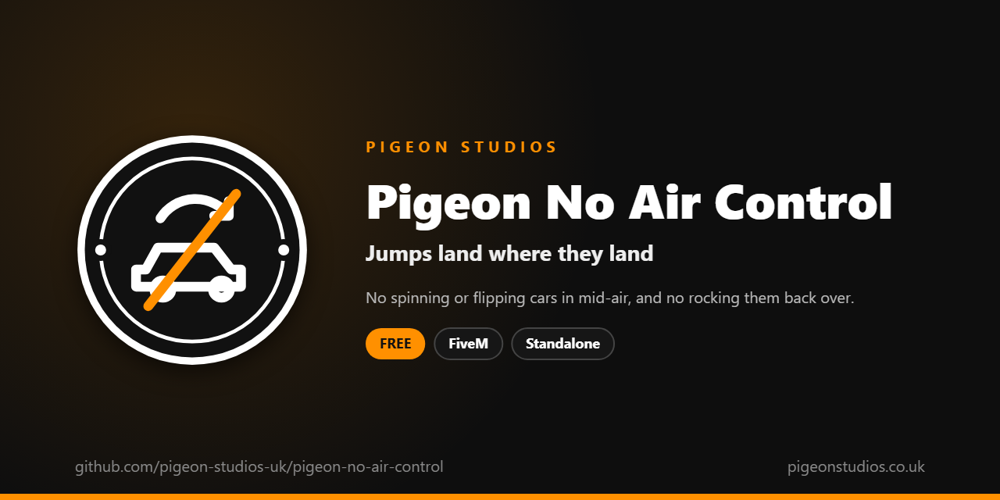

<div align="center">
  

  <h1>Pigeon No Air Control</h1>

  <p><strong>Stops drivers spinning and flipping cars in mid-air, and rocking upside-down cars back onto their wheels.</strong></p>

  <p>
    <a href="https://github.com/pigeon-studios-uk/pigeon-no-air-control/releases/latest"></a>
    <a href="LICENSE.md"></a>
    <a href="https://discord.gg/2NFVWEUmDF"></a>
    
  </p>

  <p>
    <a href="https://github.com/pigeon-studios-uk/pigeon-no-air-control/releases/latest"><strong>Download</strong></a> ·
    <a href="#installation">Install</a> ·
    <a href="#configuration">Configure</a> ·
    <a href="CHANGELOG.md">Changelog</a> ·
    <a href="https://discord.gg/2NFVWEUmDF">Support</a>
  </p>
</div>

---

## Contents

- [Overview](#overview)
- [Features](#features)
- [Requirements](#requirements)
- [Installation](#installation)
- [Updating](#updating)
- [Configuration](#configuration)
- [How it works](#how-it-works)
- [Update checker](#update-checker)
- [Performance](#performance)
- [Security](#security)
- [Troubleshooting](#troubleshooting)
- [FAQ](#faq)
- [Support](#support)
- [Contributing](#contributing)
- [Licence](#licence)
- [Credits](#credits)

## Overview

Pigeon No Air Control is a free resource by [Pigeon Studios](https://pigeonstudios.co.uk) that takes away one of GTA's least realistic tricks. In GTA, a driver can steer their car in mid-air: spin it, flip it and turn it to land on its wheels after any jump or crash. A car on its roof can even rock itself back over. In a chase on a roleplay server, it means nobody ever really crashes.

With this resource, a car in the air goes where its jump sends it, and a car on its roof stays there. Steering works as normal the moment the wheels are back on the ground.

## Features

- **No mid-air steering.** Spinning, flipping and rolling a car in the air with steering or lean controls is switched off.
- **No rocking back over.** A car on its roof can't steer itself back onto its wheels (you can turn this off).
- **Normal on the ground.** Nothing changes while the wheels are down.
- **Bikes your choice.** Motorbikes are left alone by default, because leaning in the air is how riders land; turn them on if you like.
- **Aircraft untouched.** Helicopters, planes, boats, cycles and trains are never affected.
- **Skip any vehicle.** By class or by spawn name, such as a stunt car for an event.
- **Standalone.** No framework or other resources needed.

## Requirements

| Requirement | Version | Notes |
|---|---|---|
| FXServer | A [recommended artifact](https://runtime.fivem.net/artifacts/) | |

**Frameworks:** none needed. It works the same on standalone and vMenu servers, ESX Legacy, QBCore, Qbox and ox_core.

## Installation

1. **Download** `pigeon-no-air-control.zip` from the [latest release](https://github.com/pigeon-studios-uk/pigeon-no-air-control/releases/latest). Don't use the green **Code** button; release zips are the tested builds.
2. **Extract** it into your server's `resources` folder. The folder must be called `pigeon-no-air-control`.
3. **Start it** by adding this to `server.cfg`:

   ```cfg
   ensure pigeon-no-air-control
   ```

4. **Configure** it in `configuration/config.lua` if you want to change anything. The defaults work as they are.
5. **Restart** your server. The console shows one line from the update checker:

   ```text
   [Pigeon Studios] Pigeon No Air Control v1.0.0 is up to date.
   ```

## Updating

1. Read the [changelog](CHANGELOG.md) for every version between yours and the latest, especially any **Upgrade notes**.
2. Back up your `configuration/` folder.
3. Replace the `pigeon-no-air-control` folder with the new release.
4. Copy your changed settings into the new `configuration/config.lua`. Don't copy the old file over the new one; new versions can add settings.
5. Restart the resource.

## Configuration

All settings are in `configuration/config.lua`, each explained by a comment next to it.

| Setting | Default | What it does |
|---|---|---|
| `Config.BlockWhenUpsideDown` | `true` | Stop drivers rocking an upside-down vehicle back onto its wheels |
| `Config.Motorcycles` | `false` | Include motorbikes. Off, riders can still lean in the air to land |
| `Config.SkipClasses` | 13, 14, 15, 16, 21 | Vehicle classes always left alone: cycles, boats, helicopters, planes, trains |
| `Config.SkipVehicles` | `{}` | Vehicles always left alone, by spawn name |

**Vehicle classes:** 0 compacts · 1 sedans · 2 SUVs · 3 coupes · 4 muscle · 5 sports classics · 6 sports · 7 super · 8 motorcycles · 9 off-road · 10 industrial · 11 utility · 12 vans · 13 cycles · 14 boats · 15 helicopters · 16 planes · 17 service · 18 emergency · 19 military · 20 commercial · 21 trains · 22 open wheel.

## How it works

While the player is driving a vehicle the resource covers, every frame it asks GTA whether the vehicle is in the air (`IsEntityInAir`) or, with `Config.BlockWhenUpsideDown`, on its roof (`IsEntityUpsidedown`). If it is, the six vehicle movement controls GTA uses for steering and leaning (`INPUT_VEH_MOVE_LR`, `_UD` and the four single-direction ones, 59 to 64) are switched off for that frame. As soon as the vehicle is back on its wheels, they work again.

Only the driver's controls change, and only in their own game.

## Update checker

When it starts, Pigeon No Air Control checks our public [version registry](https://github.com/pigeon-studios-uk/pigeon-versions) once and prints one line in the server console saying whether it's up to date. If there's an update, it shows what's new and where to get it. The check is a single request to GitHub and sends nothing about your server or players.

Control it for every Pigeon Studios resource at once in `server.cfg`:

```cfg
set pigeon_update_check "on"      # default: one line per resource
set pigeon_update_check "quiet"   # only when there's an update or a problem
set pigeon_update_check "off"     # never check
```

## Performance

On foot, and in vehicles it leaves alone, it checks four times a second and does nothing else. While driving, it asks GTA two questions every frame, which costs next to nothing. Nothing runs on the server apart from the update check at start-up.

## Security

- It runs only in each player's own game and only changes that player's driving controls.
- It has no commands, exports or network events, so there is nothing other players, other resources or the server can send it.
- The only network request is the update check at start-up, from the server to GitHub. It sends nothing about your server or players.
- Like every rule that runs in the player's game, a player with a modified game could get around it. It's a gameplay rule, not an anti-cheat.

Found a problem? Please don't open a public issue. Use the **Report a vulnerability** button in this repository's **Security** tab, or follow our [Security Policy](https://github.com/pigeon-studios-uk/.github/blob/main/SECURITY.md).

## Troubleshooting

**Players can still flip their car in the air.**
Check the resource is started and there are no errors in the F8 console. Check the vehicle's class isn't in `Config.SkipClasses` and the vehicle isn't in `Config.SkipVehicles`. Motorbikes need `Config.Motorcycles = true`.

**A car on its roof can still roll back over.**
Check `Config.BlockWhenUpsideDown` is `true`. GTA can still roll a car over by itself, from the way it landed; the resource only stops the driver steering it over.

**Players can't get their car off its roof.**
That's the point of `Config.BlockWhenUpsideDown`. Turn it off if you'd rather they could, or give them a way to flip vehicles, such as a mechanic job or a tow.

**The console says "isn't in the version registry" or "couldn't check for updates".**
Your server couldn't reach GitHub, or the check is blocked by a firewall. The resource works normally either way. Turn the check off with `set pigeon_update_check "off"`.

## FAQ

**Is it really free?**
Yes. Use it on as many servers as you like, including ones that take donations. You just can't reupload, resell or bundle it. See [Licence](#licence).

**Does it work on standalone and vMenu servers?**
Yes. It needs no framework at all, and works alongside vMenu.

**Does it change how cars handle on the ground?**
No. Steering is only switched off while the vehicle is in the air or on its roof.

**Does it affect NPC drivers?**
No. It only changes the player's own controls.

## Support

Read [Troubleshooting](#troubleshooting) first, then ask in the support channels of our [Discord](https://discord.gg/2NFVWEUmDF). Please include your Pigeon No Air Control version, FXServer artifact, the vehicle and any errors from the console (F8 in game). See [Getting help](https://github.com/pigeon-studios-uk/.github/blob/main/SUPPORT.md).

Found a bug? Open a [bug report](https://github.com/pigeon-studios-uk/pigeon-no-air-control/issues/new/choose).

## Contributing

Fixes and improvements are welcome. Please read the [contributing guide](https://github.com/pigeon-studios-uk/.github/blob/main/CONTRIBUTING.md) first, and open a feature request before working on anything big.

## Licence

Pigeon No Air Control is free to use under the **[Pigeon Studios Free Licence](LICENSE.md)**.

- ✅ Use it on any number of servers, including monetised ones
- ✅ Change it for your own servers
- ✅ Show it in videos and streams
- ❌ Don't reupload, share or mirror the files; link to this repository instead
- ❌ Don't sell it, bundle it in packs, or put it behind escrow
- ❌ Don't remove the credits

This summary isn't the licence; [LICENSE.md](LICENSE.md) is. Third-party components are listed in [NOTICE.md](NOTICE.md).

## Credits

Made by [Pigeon Studios](https://pigeonstudios.co.uk). Thanks to everyone who has contributed fixes; see the [changelog](CHANGELOG.md).

<sub>Not affiliated with or endorsed by Rockstar Games, Take-Two Interactive or Cfx.re.</sub>
